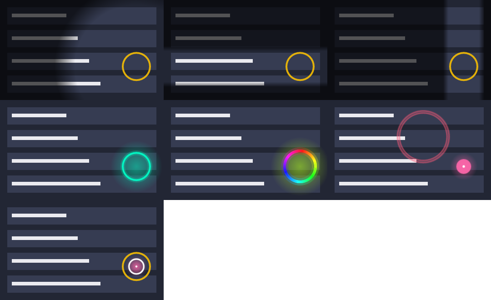
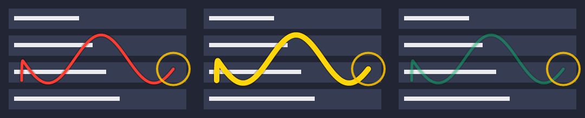

# Lumo — surligneur de curseur pour Windows

[🇬🇧 English](README.md) · 🇫🇷 Français

Lumo est un surligneur de curseur libre et open source pour Windows, écrit en Rust. Il s'inspire de [Mouzz](https://mouzz.dev/) (macOS) dont il reprend les effets gratuits, puis y ajoute un **curseur personnalisé façon osu!**, un **anneau arc-en-ciel (RGB)** et des **annotations à l'écran**. Lumo est un projet indépendant, sans lien avec Mouzz.



## Fonctionnalités

| Fonction | Statut |
|---|---|
| Spotlight : cercle, barre horizontale, barre verticale ; taille, assombrissement, douceur | ✅ |
| Anneau : taille, épaisseur, couleur, pulsation, halo néon | ✅ (+ effet **arc-en-ciel / RGB** rotatif) |
| Traînée : 7 styles (ligne, comète, lueur, points, étoiles, cœurs, arc-en-ciel) | ✅ (+ un 8ᵉ style utilisant le `cursortrail.png` d'un skin osu!) |
| Effets de clic : 7 styles (anneau, onde, pulsation, rayons, confettis, étoiles, cœurs) ; couleur distincte pour le clic droit | ✅ |
| Sons de clic : son intégré ou fichier `.wav` personnel | ✅ |
| Secouer la souris pour localiser le curseur | ✅ |
| Raccourcis globaux personnalisables (aucun par défaut) | ✅ |
| Icône de la zone de notification : activer/désactiver les effets, choisir les styles | ✅ |
| Fenêtre de réglages avec aperçu en direct | ✅ |
| **Curseur personnalisé façon osu!** (mode système ou overlay, skins osu! pris en charge) | ✅ |
| Annotations à l'écran : maintenir une touche et déplacer la souris pour dessiner | ✅ (touche configurable, `Ctrl+Alt` par défaut) |
| Fonctions Pro de Mouzz (enregistreur, sous-titres, caméra, frappes, zoom, loupe, mode focus) | ❌ hors périmètre |

## Installation

Prérequis : Windows 10 (version 1703 ou ultérieure) ou Windows 11. La fenêtre de réglages utilise le runtime Microsoft Edge WebView2, fourni avec Windows 11 et les mises à jour récentes de Windows 10 ; s'il est absent, Lumo ouvre à la place une fenêtre de réglages Windows classique. Rien d'autre n'est nécessaire : l'interface est intégrée à `lumo.exe`, sans serveur local ni navigateur.

**Depuis les sources**, avec [Rust](https://rustup.rs/) et la toolchain MSVC (Visual Studio Build Tools, charge de travail « Développement Desktop en C++ ») :

```powershell
git clone https://github.com/ShjnAki/lumo.git
cd lumo
cargo build --release
# -> target\release\lumo.exe  (exécutable autonome)
```

Le workflow GitHub Actions `.github/workflows/build.yml` compile aussi `lumo.exe` sur `windows-latest` et le publie comme artefact de build.

## Utilisation

1. Lancez `lumo.exe`. Une icône apparaît près de l'horloge et la fenêtre de réglages s'ouvre. L'anneau et les effets de clic sont actifs par défaut.
2. Un **clic gauche** sur l'icône rouvre la fenêtre de réglages ; un **clic droit** affiche le menu complet. Avec `lumo.exe --minimized`, Lumo démarre directement dans la zone de notification.
3. Chaque modification est appliquée immédiatement et enregistrée dans `%APPDATA%\Lumo\settings.json`. Le fichier est aussi rechargé à chaud lorsqu'il est modifié à la main.
4. Si Lumo est arrêté brutalement (gestionnaire des tâches), `lumo.exe --restore-cursors` rétablit les curseurs Windows d'origine.

Tous les réglages sont listés dans [`settings.example.json`](settings.example.json). Les couleurs s'écrivent `#RRGGBB` ou `#RRGGBBAA`.

### Fenêtre de réglages

- Une barre latérale donne accès aux huit pages (Général, Spotlight, Anneau, Traînée, Clics, Annotations, Curseur, Raccourcis). Le point à côté d'une page indique si l'effet est actif.
- Un aperçu en direct, en haut de chaque page, fait tourner le vrai moteur d'effets avec vos réglages du moment.
- L'interrupteur principal de chaque page se trouve dans l'en-tête ; les autres réglages sont grisés tant qu'il est coupé.
- Les boutons **Détecter** enregistrent un raccourci ou les touches d'annotation : cliquez, appuyez sur les touches, relâchez. **Parcourir…** choisit le son de clic ou le dossier du skin osu!.
- La fenêtre suit le thème clair ou sombre de Windows. `Échap` la ferme.
- `lumo.exe --native-ui` ouvre la fenêtre Windows classique à la place (celle utilisée quand WebView2 est absent).

### Curseur façon osu!

```json
"cursor": {
  "mode": "overlay",
  "size": 48,
  "color": "#ff66aa",
  "skin_dir": "C:/Users/vous/AppData/Local/osu!/Skins/MonSkin",
  "press_scale": 1.25,
  "rotate": false,
  "outline": false
}
```

- `"mode": "system"` : le vrai curseur Windows est remplacé par l'image (aucune latence ajoutée, pas d'animation).
- `"mode": "overlay"` : le curseur natif est masqué et Lumo dessine le sien, avec un agrandissement au clic (`press_scale`) et une rotation optionnelle (`rotate`).
- `skin_dir` : dossier d'un skin osu! (`cursor`, `cursormiddle`, `cursortrail` ; variantes `@2x` privilégiées). Laissez-le vide pour le curseur généré. Dans le JSON, les chemins s'écrivent avec `/` ou `\\`.
- `outline` (désactivé par défaut) : ajoute un liseré blanc autour du curseur généré.
- Pour utiliser la traînée du skin : `"trail": { "enabled": true, "style": "skin" }`.

### Anneau RGB

```json
"ring": { "rgb": true, "rgb_speed": 120, "thickness": 6, "glow": true }
```

Un dégradé arc-en-ciel tourne autour de l'anneau. `rgb_speed` est en degrés par seconde (`360` = un tour par seconde, valeur négative = sens inverse). `rgb` remplace la teinte de `color` mais conserve son opacité. L'effet s'applique aussi à l'anneau « secouer pour localiser » et s'active depuis le menu de l'icône : *Anneau → Effet RGB*.

### Annotations

Maintenez **Ctrl gauche + Alt gauche** et déplacez la souris : un tracé se dessine, sans clic. Une fois les touches relâchées, il s'efface au bout de 2,5 s.



```json
"annotate": { "enabled": true, "key": "Ctrl+Alt", "color": "#ff3b30", "width": 5, "fade_delay": 2.5 }
```

- `key` : touches maintenues ensemble (`Ctrl`, `Alt`, `Shift`, `Win` = touches de gauche ; `RCtrl`, `RAlt`, `RShift`, `RWin`, `CapsLock`, lettres, chiffres, `F1`–`F24`). Les touches de gauche évitent AltGr, qui équivaut à Ctrl gauche + Alt droit sur de nombreuses dispositions (AZERTY, par exemple). Dans la fenêtre de réglages, **Détecter** remplit ce champ : maintenez les touches, puis relâchez.
- `fade_delay` : secondes avant l'effacement ; `0` conserve le tracé jusqu'à `clear_annotations` (raccourci ou menu de l'icône).
- **La touche `Fn` est inutilisable.** Sur presque tous les claviers, elle est gérée par le firmware du clavier et Windows ne la voit jamais. Vous pouvez réassigner une touche vers `F13`–`F24` avec le logiciel du clavier (iCUE, QMK/VIA, outil du constructeur), puis régler `"key": "F13"`.

### Raccourcis

```json
"hotkeys": { "toggle_all": "Ctrl+Alt+L", "toggle_spotlight": "Ctrl+Alt+S", "clear_annotations": "Ctrl+Alt+C" }
```

Au moins un modificateur (`Ctrl`, `Alt`, `Shift`, `Win`) est obligatoire. Touches admises : lettres, chiffres, `F1`–`F24`. Dans la fenêtre de réglages, **Détecter** enregistre la combinaison, et un raccourci déjà utilisé par Windows ou une autre application y est signalé (il est sinon ignoré).

## Limites connues

- **Latence de la traînée** : Lumo ne repeint que la zone qui a changé, uniquement sur les écrans concernés, et dessine une nouvelle image dès que le hook souris signale un mouvement. Un léger retard subsiste par nature : Windows dessine directement le curseur matériel, alors que tout overlay passe par le compositeur du bureau et s'affiche un rafraîchissement d'écran plus tard.
- **Jeux en plein écran exclusif** : aucun overlay ne peut s'afficher par-dessus (limite de Windows). Le plein écran sans bordure fonctionne.
- **Curseurs définis par les applications** (certains jeux, pages web utilisant `cursor: url()`) : non remplacés, car seuls les curseurs système standards le sont.
- **Mode curseur système** : le canal alpha transmis à `CreateIconIndirect` est prémultiplié. Si les bords paraissent sales sur votre configuration, passez en mode `overlay`.

## Feuille de route

- Un portage Linux (le moteur d'effets est portable ; seule la couche de fenêtrage est propre à Windows).

## Architecture

```
src/settings.rs   réglages JSON (serde), couleurs, analyse des raccourcis
src/fx.rs         moteur d'effets : état + rendu tiny-skia, zones à repeindre (portable, testé)
src/skin.rs       chargement des skins osu! (PNG)
src/schema.rs     description des réglages (pages, champs, bornes), export JSON et validation ; testé
src/demo.rs       aperçu en direct de la fenêtre de réglages : le moteur piloté par une souris simulée ; testé
src/win.rs        couche Win32 : overlays, hook souris, icône de notification, raccourcis, curseurs
src/webui.rs      fenêtre de réglages : fenêtre Win32 hébergeant WebView2 (wry), messages page <-> Rust
ui/index.html     page de réglages (HTML/CSS/JS, intégrée à l'exe), construite depuis le schéma
src/winui.rs      point d'entrée de la fenêtre de réglages et fenêtre Win32 classique de repli
build.rs + lumo.manifest   styles de contrôles Windows modernes (comctl32 v6) et DPI par écran (MSVC)
src/bin/preview   génère des planches PNG de contrôle (enregistrées dans docs/), fonctionne sous Linux
```

- Une fenêtre `WS_EX_LAYERED | WS_EX_TRANSPARENT | WS_EX_TOPMOST | WS_EX_NOACTIVATE` par écran, avec alpha par pixel via `UpdateLayeredWindowIndirect`. Elle ne capture jamais un clic.
- Les clics proviennent d'un hook `WH_MOUSE_LL`. Chaque mouvement qu'il signale déclenche une image (au plus une toutes les 3 ms) ; un minuteur d'environ 8 ms cadence les animations. La position provient de `GetCursorPos`.
- Seule la zone qui a changé est redessinée, convertie et envoyée à Windows (`UpdateLayeredWindowIndirect` avec un rectangle modifié). Un écran sans rien à dessiner voit sa fenêtre masquée. Au repos, le rendu s'arrête.
- La page de réglages ne code aucun réglage en dur : Rust injecte `schema::to_json()` et les réglages courants, la page en déduit ses contrôles et renvoie des messages `{ path, value }`, que Rust valide (`schema::validate`) avant de les appliquer.
- Tout s'exécute sur un seul thread ; l'état de l'application réside dans des cellules `thread_local!`.

## Développement et tests

```powershell
cargo test --lib            # moteur d'effets et schéma des réglages (portable)
cargo run --release         # lancer Lumo (Windows, toolchain MSVC)
cargo run --bin preview     # générer les planches PNG de contrôle des effets (docs/)
```

- Le moteur d'effets, les zones à repeindre, l'aperçu en direct et le schéma des réglages sont couverts par 30 tests unitaires ; le rendu est contrôlé grâce aux planches PNG de `docs/`.
- La couche Win32 (overlays, hook, icône de notification, fenêtre de réglages) n'a pas de tests automatisés et se vérifie à la main sous Windows.

## Contribuer

Les issues et pull requests sont les bienvenues. Pour ajouter un réglage, mettez à jour `src/settings.rs` et `src/schema.rs` : les tests du schéma échouent si un réglage n'a pas de champ correspondant dans la fenêtre. La page de réglages récupère d'elle-même les nouveaux champs depuis le schéma.
