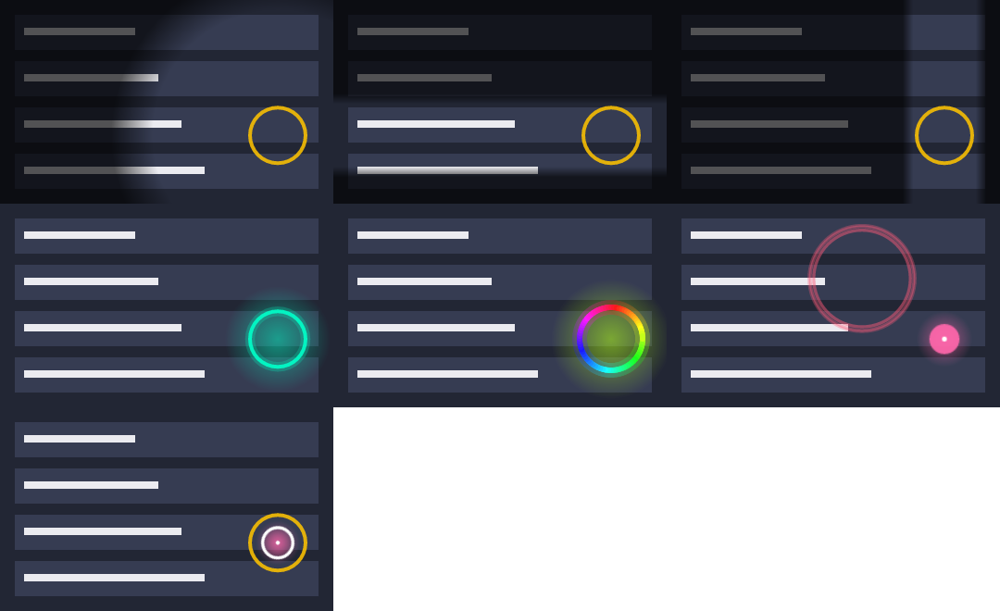

# Lumo — cursor highlighter for Windows

🇬🇧 English · [🇫🇷 Français](README.fr.md)

Lumo is a free, open-source cursor highlighter for Windows, written in Rust. It is inspired by [Mouzz](https://mouzz.dev/) (macOS) and reproduces its free effects, then adds an **osu!-style custom cursor**, a **rainbow (RGB) ring** and **on-screen annotations**. Lumo is an independent project and is not affiliated with Mouzz.



## Features

| Feature | Status |
|---|---|
| Spotlight: circle, horizontal bar, vertical bar; size, dimming, softness | ✅ |
| Ring: size, thickness, colour, pulse, neon glow | ✅ (+ rotating **rainbow / RGB** effect) |
| Trail: 7 styles (line, comet, glow, dots, stars, hearts, rainbow) | ✅ (+ an 8th style using an osu! skin's `cursortrail.png`) |
| Click effects: 7 styles (ring, ripple, pulse, burst, confetti, stars, hearts); separate colour for right-click | ✅ |
| Click sounds: built-in sound or your own `.wav` file | ✅ |
| Shake the mouse to locate the cursor | ✅ |
| Customisable global hotkeys (none set by default) | ✅ |
| Tray icon: toggle effects, pick styles | ✅ |
| Settings window with live preview | ✅ |
| **osu!-style custom cursor** (system or overlay mode, osu! skins supported) | ✅ |
| On-screen annotations: hold a key and move the mouse to draw | ✅ (configurable key, `Ctrl+Alt` by default) |
| Mouzz Pro features (recorder, captions, camera, keystrokes, zoom, magnifier, focus mode) | ❌ out of scope |

## Installation

Requirements: Windows 10 (1703 or later) or Windows 11. The settings window uses the Microsoft Edge WebView2 Runtime, which ships with Windows 11 and recent Windows 10 updates; without it, Lumo falls back to a classic Windows settings window. Nothing else is needed: the interface is embedded in `lumo.exe`, with no local server and no browser.

**From source**, with [Rust](https://rustup.rs/) and the MSVC toolchain (Visual Studio Build Tools, "Desktop development with C++" workload):

```powershell
git clone https://github.com/ShjnAki/lumo.git
cd lumo
cargo build --release
# -> target\release\lumo.exe  (standalone executable)
```

The GitHub Actions workflow in `.github/workflows/build.yml` also builds `lumo.exe` on `windows-latest` and uploads it as a build artifact.

## Usage

1. Run `lumo.exe`. A tray icon appears near the clock and the settings window opens. The ring and click effects are enabled by default.
2. **Left-click** the tray icon to reopen the settings window. **Right-click** it for the full menu. Start with `lumo.exe --minimized` to launch straight into the tray.
3. Every change is applied immediately and saved to `%APPDATA%\Lumo\settings.json`. The file is also reloaded live when edited by hand.
4. If Lumo is killed abruptly (Task Manager), run `lumo.exe --restore-cursors` to bring back the original Windows cursors.

All settings are listed in [`settings.example.json`](settings.example.json). Colours use `#RRGGBB` or `#RRGGBBAA`.

### Settings window

- A sidebar lists the eight pages (General, Spotlight, Ring, Trail, Clicks, Annotations, Cursor, Hotkeys). The dot next to a page shows whether that effect is on.
- A live preview at the top of each page runs the real effects engine with your current settings.
- Each page has its main switch in the header; the other settings are dimmed while it is off.
- **Detect** buttons record a hotkey or the annotation keys: click, press the keys, release. **Browse…** picks the click sound or the osu! skin folder.
- The window follows the Windows light or dark theme. `Esc` closes it.
- `lumo.exe --native-ui` opens the classic Windows window instead (the same one used when WebView2 is missing).

### osu!-style cursor

```json
"cursor": {
  "mode": "overlay",
  "size": 48,
  "color": "#ff66aa",
  "skin_dir": "C:/Users/you/AppData/Local/osu!/Skins/MySkin",
  "press_scale": 1.25,
  "rotate": false,
  "outline": false
}
```

- `"mode": "system"`: the real Windows cursor is replaced by the image (no added latency, no animation).
- `"mode": "overlay"`: the native cursor is hidden and Lumo draws its own, with a size increase on click (`press_scale`) and optional rotation (`rotate`).
- `skin_dir`: folder of an osu! skin (`cursor`, `cursormiddle`, `cursortrail`; `@2x` variants preferred). Leave empty for the generated cursor. Use `/` or `\\` in JSON paths.
- `outline` (off by default): adds a white outline around the generated cursor.
- To use the skin's trail: `"trail": { "enabled": true, "style": "skin" }`.

### RGB ring

```json
"ring": { "rgb": true, "rgb_speed": 120, "thickness": 6, "glow": true }
```

A rainbow gradient rotates around the ring. `rgb_speed` is in degrees per second (`360` = one turn per second, negative = reverse direction). `rgb` replaces the hue of `color` but keeps its opacity. It also applies to the "shake to locate" ring. It can be toggled from the tray menu: *Ring → RGB effect*.

### Annotations

Hold **left Ctrl + left Alt** and move the mouse: a stroke is drawn, no click needed. Once released, it fades out after 2.5 s.


```json
"annotate": { "enabled": true, "key": "Ctrl+Alt", "color": "#ff3b30", "width": 5, "fade_delay": 2.5 }
```

- `key`: keys held together (`Ctrl`, `Alt`, `Shift`, `Win` = left-hand keys; `RCtrl`, `RAlt`, `RShift`, `RWin`, `CapsLock`, letters, digits, `F1`–`F24`). Left-hand keys avoid AltGr, which counts as left Ctrl + right Alt on many layouts (AZERTY, for example). In the settings window, **Detect** fills it in: hold the keys, then release.
- `fade_delay`: seconds before the stroke fades; `0` keeps it until `clear_annotations` (hotkey or tray menu).
- **The `Fn` key cannot be used.** On almost every keyboard it is handled by the keyboard firmware and Windows never sees it. A workaround is to remap a key to `F13`–`F24` with your keyboard software (iCUE, QMK/VIA, vendor tools), then set `"key": "F13"`.

### Hotkeys

```json
"hotkeys": { "toggle_all": "Ctrl+Alt+L", "toggle_spotlight": "Ctrl+Alt+S", "clear_annotations": "Ctrl+Alt+C" }
```

At least one modifier (`Ctrl`, `Alt`, `Shift`, `Win`) is required. Keys: letters, digits, `F1`–`F24`. In the settings window, **Detect** records the combination, and a hotkey already taken by Windows or another application is reported there (it is otherwise ignored).

## Known limitations

- **Trail latency**: Lumo only repaints the area that changed, only on the monitors concerned, and draws a new frame as soon as the mouse hook reports a movement. A small lag remains by nature: Windows draws the hardware cursor directly, while any overlay goes through the desktop compositor and is shown one screen refresh later.
- **Exclusive full-screen games**: no overlay can be drawn on top (a Windows limitation). Borderless full-screen works.
- **Application-defined cursors** (some games, web pages using `cursor: url()`): not replaced, because only the standard system cursors are.
- **System cursor mode**: the alpha channel passed to `CreateIconIndirect` is premultiplied. If the edges look dirty on your setup, switch to `overlay` mode.

## Roadmap

- A Linux port (the effects engine is portable; only the windowing layer is Windows-specific).

## Architecture

```
src/settings.rs   JSON settings (serde), colours, hotkey parsing
src/fx.rs         effects engine: state + tiny-skia rendering, repaint areas (portable, tested)
src/skin.rs       osu! skin loading (PNG)
src/schema.rs     description of the settings (pages, fields, bounds), JSON export and validation; tested
src/demo.rs       live preview of the settings window: the engine driven by a simulated mouse; tested
src/win.rs        Win32 layer: overlays, mouse hook, tray icon, hotkeys, cursors
src/webui.rs      settings window: Win32 window hosting WebView2 (wry), page <-> Rust messages
ui/index.html     settings page (HTML/CSS/JS, embedded in the exe), built from the schema
src/winui.rs      settings window entry point and classic Win32 fallback window
build.rs + lumo.manifest   modern Windows control styles (comctl32 v6) and per-monitor DPI (MSVC)
src/bin/preview   renders PNG test sheets (saved in docs/), runs on Linux
```

- One `WS_EX_LAYERED | WS_EX_TRANSPARENT | WS_EX_TOPMOST | WS_EX_NOACTIVATE` window per monitor, per-pixel alpha through `UpdateLayeredWindowIndirect`. It never captures a click.
- Clicks come from a `WH_MOUSE_LL` hook. Each movement it reports triggers a frame (at most one every 3 ms); a ~8 ms timer drives animations. The position comes from `GetCursorPos`.
- Only the changed area is redrawn, converted and sent to Windows (`UpdateLayeredWindowIndirect` with a dirty rectangle). A monitor with nothing to draw has its window hidden. When idle, rendering stops.
- The settings page never hard-codes a setting: Rust injects `schema::to_json()` and the current settings, the page builds its controls from them and sends `{ path, value }` messages back, which Rust validates (`schema::validate`) before applying.
- Everything runs on a single thread; application state lives in `thread_local!` cells.

## Development and testing

```powershell
cargo test --lib            # effects engine and settings schema (portable)
cargo run --release         # run Lumo (Windows, MSVC toolchain)
cargo run --bin preview     # render PNG test sheets of the effects (docs/)
```

- The effects engine, the repaint areas, the live preview and the settings schema are covered by 30 unit tests; rendered output is checked through the PNG sheets in `docs/`.
- The Win32 layer (overlays, hook, tray icon, settings window) has no automated tests and is verified by hand on Windows.

## Contributing

Issues and pull requests are welcome. When adding a setting, update `src/settings.rs` and `src/schema.rs`: the schema tests fail if a setting has no matching field in the window. The settings page picks up new fields from the schema on its own.
