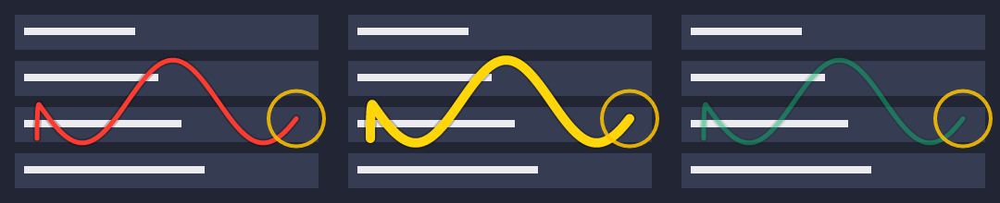

# Lumo — surligneur de curseur pour Windows

Clone libre, inspiré de [Mouzz](https://mouzz.dev/) (macOS), écrit en Rust. Il ajoute le **curseur custom façon osu!** que tu voulais.


## Fonctionnalités

| Fonction (équivalent Mouzz gratuit) | Statut |
|---|---|
| Spotlight : cercle, barre horizontale, barre verticale ; taille, assombrissement, douceur | ✅ |
| Ring : taille, épaisseur, couleur, pulsation | ✅ (+ halo « neon », qui est du Pro chez Mouzz, + **effet RGB** arc-en-ciel rotatif) |
| Traînée : 7 styles (ligne, comète, lueur, points, étoiles, cœurs kawaii, arc-en-ciel) | ✅ (+ un 8ᵉ style : `cursortrail.png` d'un skin osu!) |
| Effets de clic : 7 styles (anneau, onde, pulsation, rayons, confettis, étoiles, cœurs) ; couleur distincte clic droit | ✅ |
| Sons de clic : son intégré ou fichier `.wav` | ✅ |
| Secouer la souris pour localiser le curseur | ✅ |
| Raccourcis globaux personnalisables (aucun par défaut) | ✅ |
| Icône de zone de notification : activer/désactiver, choix des styles | ✅ |
| **Curseur custom osu!** (mode système ou overlay, skins `cursor.png`/`cursormiddle.png`/`cursortrail.png`) | ✅ (ajout) |
| Annotations à l'écran : maintenir une touche et bouger la souris pour dessiner | ✅ (touche configurable, `Ctrl+Alt` par défaut : Windows ne voit pas Fn) |
| Pro : enregistreur, sous-titres, caméra, frappes, zoom, loupe, focus mode | ❌ hors périmètre |

Les réglages se font dans la **fenêtre de réglages** (clic gauche sur l'icône de la zone de notification, ou au lancement), par le menu de l'icône (clic droit) **ou** dans `%APPDATA%\Lumo\settings.json`. Chaque changement est appliqué tout de suite (aperçu en direct) et enregistré. Le fichier est aussi rechargé à chaud.

## Compiler

Prérequis : Rust (`rustup`) avec la toolchain MSVC (Visual Studio Build Tools, charge de travail « Desktop development with C++ »). Tu as déjà ça pour le projet Tauri.

```powershell
cargo build --release
# -> target\release\lumo.exe  (exécutable autonome)
```

Sans toolchain locale, pousse le dépôt sur GitHub : le workflow `.github/workflows/build.yml` compile sur `windows-latest` et publie `lumo.exe` en artefact.

## Utilisation

1. Lance `lumo.exe` : une icône rose apparaît près de l'horloge. Le ring et les clics sont actifs par défaut.
2. La fenêtre de réglages s'ouvre au lancement (`lumo.exe --minimized` pour démarrer seulement dans la zone de notification). Clic gauche sur l'icône : rouvre la fenêtre. Clic droit : menu complet (dont « Tout activer/désactiver »).
3. `lumo.exe --restore-cursors` rend les curseurs Windows d'origine si le programme a été tué brutalement (gestionnaire des tâches).

### Curseur osu!

Dans `settings.json` :

```json
"cursor": {
  "mode": "overlay",
  "size": 48,
  "color": "#ff66aa",
  "skin_dir": "C:/Users/toi/AppData/Local/osu!/Skins/MonSkin",
  "press_scale": 1.25,
  "rotate": false
}
```

- `"mode": "system"` : le vrai curseur Windows est remplacé par l'image (zéro latence, pas d'animation).
- `"mode": "overlay"` : le curseur natif est masqué et l'app dessine le sien, avec agrandissement au clic (`press_scale`) et rotation optionnelle (`rotate`).
- `skin_dir` : dossier d'un skin osu! (variantes `@2x` préférées). Laisse vide pour le curseur généré. Utilise des `/` ou des `\\` dans le JSON.
- `outline` (faux par défaut) : ajoute un liseré blanc autour du curseur généré.
- Pour utiliser la traînée du skin : `"trail": { "enabled": true, "style": "skin" }`.

### Anneau RGB

```json
"ring": { "rgb": true, "rgb_speed": 120, "thickness": 6, "glow": true }
```

Un dégradé arc-en-ciel tourne autour de l'anneau (dans la capture, 6ᵉ vignette, l'anneau RGB avec halo). `rgb_speed` est en degrés par seconde (`360` = un tour par seconde, négatif = sens inverse). `rgb` remplace la teinte de `color`, mais son opacité est conservée. Il s'applique aussi à l'anneau « secouer pour localiser » et se règle dans le menu : *Anneau → Effet RGB*.

### Annotations

Maintiens **Ctrl gauche + Alt gauche** et bouge la souris : un tracé se dessine, sans cliquer. Au relâchement, il s'efface après 2,5 s.



```json
"annotate": { "enabled": true, "key": "Ctrl+Alt", "color": "#ff3b30", "width": 5, "fade_delay": 2.5 }
```

- `key` : touches tenues simultanément (`Ctrl`, `Alt`, `Shift`, `Win` = touches de gauche ; `RCtrl`, `RAlt`, `RShift`, `RWin`, `CapsLock`, lettres, chiffres, `F1`–`F24`). Les touches de gauche évitent AltGr, qui vaut Ctrl gauche + Alt droit sur un clavier AZERTY.
- `fade_delay` : secondes avant l'effacement ; `0` garde le tracé jusqu'à `clear_annotations` (raccourci ou menu « Effacer les annotations »).

### Raccourcis

```json
"hotkeys": { "toggle_all": "Ctrl+Alt+L", "toggle_spotlight": "Ctrl+Alt+S", "clear_annotations": "Ctrl+Alt+C" }
```

Un modificateur (`Ctrl`, `Alt`, `Shift`, `Win`) est obligatoire. Touches : lettres, chiffres, `F1`–`F24`. Les raccourcis déjà pris par une autre application sont ignorés sans message.

Toutes les clés sont listées dans `settings.example.json`. Les couleurs sont en `#RRGGBB` ou `#RRGGBBAA`.

## Architecture

```
src/settings.rs   réglages JSON (serde), couleurs, parsing des raccourcis
src/fx.rs         moteur : état + rendu tiny-skia (portable, testé)
src/skin.rs       chargement des skins osu! (PNG)
src/schema.rs     description des réglages (pages, champs, bornes) qui pilote la fenêtre ; testée
src/win.rs        couche Win32 : overlays, hook souris, tray, hotkeys, curseurs
src/winui.rs      fenêtre de réglages native (onglets, curseurs, sélecteur de couleur), sans serveur ni navigateur
build.rs + lumo.manifest   styles Windows modernes (comctl32 v6) et DPI par écran (MSVC)
src/bin/preview   rendu de contrôle en PNG (planches dans docs/), tourne sous Linux
```

- Une fenêtre `WS_EX_LAYERED | WS_EX_TRANSPARENT | WS_EX_TOPMOST | WS_EX_NOACTIVATE` par écran, alpha par pixel via `UpdateLayeredWindow`. Elle ne capture aucun clic.
- Les clics viennent d'un hook `WH_MOUSE_LL` ; la position vient de `GetCursorPos`, relevée toutes les ~8 ms.
- Un écran sans rien à dessiner voit sa fenêtre masquée. Au repos, le rendu s'arrête.

## État de la vérification

- Moteur d'effets et schéma des réglages : 18 tests unitaires, rendus PNG relus (`docs/`).
- Couche Win32 (dont la fenêtre de réglages) : **type-check complet contre `windows-sys 0.59` réussi**, mais ni liée ni exécutée dans l'environnement de création (pas de cible Windows). Premier lancement : à surveiller.

Points à vérifier en premier si quelque chose cloche :

1. **Halo autour du curseur système** : l'alpha de `CreateIconIndirect` est fourni prémultiplié. Si les bords semblent sales, passe en `overlay`, ou dé-prémultiplie dans `make_icon` (`win.rs`).
2. **Jeux en plein écran exclusif** : aucun overlay ne passe au-dessus (limite de Windows). Le plein écran « sans bordure » fonctionne.
3. **Latence de la traînée** (constatée) et performance sur grand écran : chaque écran visible est repeint en entier à chaque image, et la position vient d'un relevé toutes les ~8 ms. Pistes : ne repeindre que la zone modifiée, n'afficher que l'écran actif, utiliser les positions du hook souris. À optimiser ensuite.
4. **Curseurs applicatifs custom** (certains jeux, navigateurs avec `cursor: url()`) : non remplacés, car seuls les curseurs système standards le sont.
5. **Fenêtre de réglages** : mise en page jamais vue à l'écran (écrite à l'aveugle). Si des contrôles se chevauchent ou si les couleurs de fond sont fausses, signale-le avec une capture.
